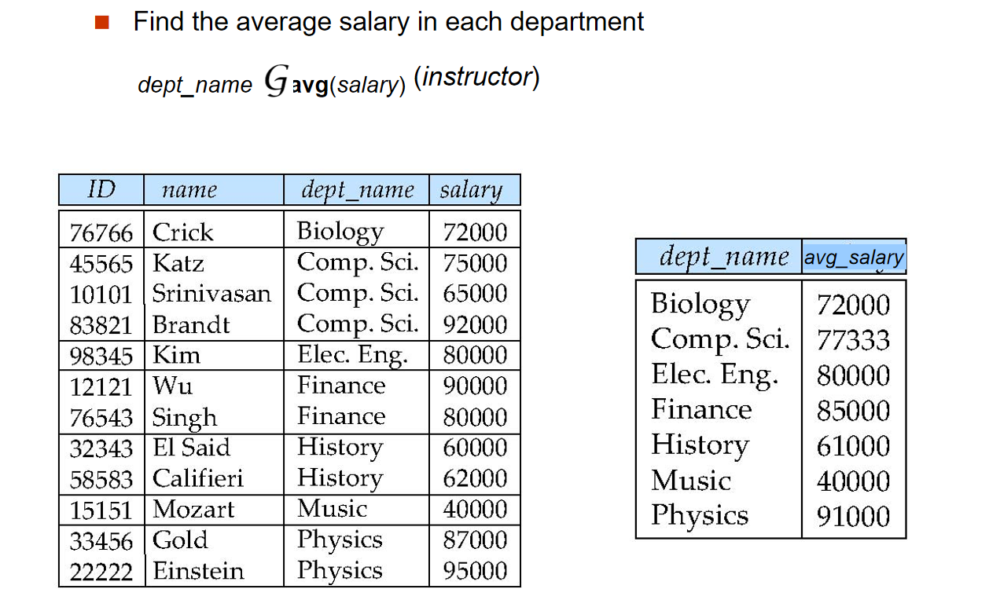

# SQL语言介绍

## SQL的历史

SQL（Structured Query Language）是一种用于管理关系型数据库的标准语言。它的历史可以追溯到20世纪70年代，最初由IBM的研究人员开发。

SQL历史的一些重要里程碑：

- **1970年**：Edgar F. Codd提出了关系模型的概念，并在其论文中描述了如何使用关系代数来操作数据。

- **1974年**：IBM的研究人员开始开发SEQUEL（Structured English Query Language），这是SQL的前身。

- **1979年**：Oracle发布了第一个商业SQL数据库。

- **1986年**：ANSI（美国国家标准协会）发布了SQL的第一个标准，称为SQL-86。

- **1992年**：SQL-92标准发布，增加了许多新特性。

- **1999年**：SQL:1999标准发布，引入了对象关系数据库的概念。

- **2003年**：SQL:2003标准发布，增加了XML支持和其他新特性。

- **2006年**：SQL:2006标准发布，增加了对XML数据类型的支持。

---

## SQL的DDL

DDL（Data Definition Language）是SQL的一个子集，用于定义和管理数据库的结构。DDL语句用于创建、修改和删除数据库对象，如表、索引和视图。其定义的对象包括：

1. The Schema for each relation(各种关系的模式)

2. The domain of values associated with each attribute(与每个属性相关的值域)

3. Integrity constraints(完整性约束)

4. The physical storage structure for each relation(每个关系的物理存储结构)

5. The set of indices to be maintained for each relations(为每个关系维护的索引集)

6. Security and authorization information for each relation(每个关系的安全性和授权信息)

---

### Domain Types(域类型)

SQL支持多种数据类型，包括：

1. char(n) - 定长字符串，n为长度

2. varchar(n) - 变长字符串，n为最大长度

3. int - 整数

4. smallint - 小整数

5. numeric(p,s) - 精确数字，p为总位数，s为小数位数

6. real,double precision - 浮点数,real相当于float(7),double相当于float(15)

7. float(p) - 浮点数，p为精度,即小数位数

---

### Built-in Types(内置类型)

所谓内置类型，即是SQL标准中定义的类型。SQL标准定义了以下几种内置类型：

1. date - 日期,包括四位数年份、两位数月份和两位数日期，如'1999-12-31'

2. time - 时间,包括小时、分钟和秒，如'12:30:00'

3. timestamp - 时间戳,包括日期和时间，如'1999-12-31 12:30:00'

4. interval - 时间间隔
   示例：interval '1' day
   从一个日期/时间/时间戳值中减去另一个得到时间间隔值
   时间间隔值可以添加到日期/时间/时间戳值


#### 日期时间函数

SQL提供了多种日期和时间处理函数：

1. current_date() - 返回当前日期

2. current_time() - 返回当前时间

3. year(x), month(x), day(x) - 提取日期的年、月、日部分

4. hour(x), minute(x), second(x) - 提取时间的时、分、秒部分


---

### Creating Tables(创建表)

使用CREATE TABLE语句创建表,其基本格式为：

``` sql
create table r (A1 D1, A2 D2, ..., An Dn,
        (integrity-constraint1),
        ...,
        (integrity-constraintk))
```

其中：

- r是表名

- Ai是属性名

- Di是属性的数据类型

- integrity-constraint是完整性约束

!!! example "🌰"
    === "🌰1"
        ``` sql
        create table student (
            sno char(8),
            sname varchar(20) not null,
            sage int,
            tuition numeric(7,2),
            dept char(4),
            primary key(sno)
            foreign key(dept) references department(deptid)
            check(sage>0 and sage<100)
        )
        ```
    === "🌰2"
        ``` sql
        create table student (
            ID          varchar(5),
            name        varchar(20) not null,
            dept_name   varchar(20),
            tot_cred    numeric(3,0) default 0,
            primary key (ID),
            foreign key (dept_name) references department
        );
        ```
    === "🌰3"
        ``` sql
        create table takes (
            ID          varchar(5),
            course_id   varchar(8),
            sec_id      varchar(8),
            semester    varchar(6),
            year        numeric(4,0),
            grade       varchar(2),
            primary key (ID, course_id, sec_id, semester, year),
            foreign key (ID) references student,
            foreign key (course_id, sec_id, semester, year) references section
        );
        ```

!!! note "foreign key约束说明"
    - foreign key约束用于定义外键约束，确保引用的表中的值存在。

    - foreign key约束的语法为：foreign key (列名) references 其他表名(列名)

    当被引用的表中的值不存在时，插入或更新操作将失败。

    对于delete和update操作，SQL标准允许以下几种行为：

    - no action：不执行任何操作，默认行为。

    - restrict：不执行任何操作，类似于no action。

    - cascade：级联删除或更新操作。

    - set null：将外键列设置为NULL。

    - set default：将外键列设置为默认值。

    - set null和set default只能在外键列允许NULL或有默认值时使用。

---

### Drop Table(删除表)& Delete Table(删除表中数据)

使用DROP TABLE语句删除表，其基本格式为：

``` sql
drop table r
```
这样会删除表r及其所有数据和结构。

使用DELETE语句删除表中数据，其基本格式为：

``` sql
delete from r
```
这样会删除表r中的所有数据，但保留表结构。

---

### Alter Table(修改表)

表结构的修改包括增加、删除和修改列等。使用ALTER TABLE语句修改表，包括：

!!! note "alter table操作"
    === "增加列"
        ``` sql title="增加列"
        alter table r add column a d
        ```
    === "删除列"
        ``` sql title="删除列"
        alter table r drop column a
        ```
    === "修改列"
        ``` sql title="修改列"
        alter table r alter column a d
        ```
    === "增加约束"
        ``` sql title="增加约束"
        alter table r add constraint c
        ```
    === "删除约束"
        ``` sql title="删除约束"    
        alter table r drop constraint c
        ```

---

## Basic SQL Queries

一个SQL查询语句的基本格式为:
``` sql
select select-list
from table-list
where condition
```

其中：

- select-list是要查询的列，可以使用*表示所有列。

- table-list是要查询的表，可以使用逗号分隔多个表。

- condition是查询条件，可以使用AND、OR、NOT等逻辑运算符。

SQL查询语句的结果是一个关系

### SQL语句的执行顺序

1. FROM：确定数据来源

2. WHERE：根据条件过滤原始表中的行

3. GROUP BY：将数据按指定列进行分组

4. HAVING：根据条件过滤分组后的结果

5. SELECT：选择最终要返回的列

6. ORDER BY：对结果进行排序

7. LIMIT：限制返回的行数

### Select Clause(选择子句)

Select语句与第二章中的projection操作相当

例如,SQL语句
``` sql
select name
from student
```
等价于

$$
\pi_{name}(student)
$$

!!! note "SQL中的大小写问题"
    SQL对大小写不敏感,即select和SELECT是一样的
    但是,表名和列名是区分大小写的,即student和STUDENT是不同的


select语句中也有一些keyword可以添加:

1. DISTINCT - 去重,即去掉重复的元组

2. ALL - 保留所有元组,包括重复的元组

select语句也支持算术操作:

```sql
select ID, name, salary/12
from instructor
```

这个语句会返回instructor表中所有教师的ID、姓名和年薪/12

### Where Clause(选择子句)

where子句用于指定查询条件,即选择满足条件的元组

where子句的基本格式为:

``` sql
where condition
```

condition可以是一个布尔表达式,即返回true或false的表达式

where子句支持以下操作:

1. 逻辑运算符: AND、OR、NOT

2. 比较运算符: =、<>、<、<=、>、>=

3. 其他运算符: BETWEEN、IN、LIKE

!!! example "🌰"
    === "🌰1"
        ``` sql
        select name from instructor
        where dept_name = ‘Comp. Sci.'and salary > 80000
        ```
    === "🌰2"
        ``` sql
        select name from instructor
        where salary between 90000 and 100000
        ```
    === "🌰3"
        ``` sql
        select name, course_id
        from instructor, teaches
        where (instructor.ID, dept_name) = (teaches.ID, ’Biology’);
        ```

### From Clause(表名子句)

from子句用于指定查询的表,选择满足条件的元组,相当于关系代数中的笛卡尔乘积

### Natural Join(自然连接)

自然连接是关系代数中的一种操作,用于连接两个表,返回满足条件的元组

自然连接的基本格式为:

``` sql
select select-list
from table1 natural join table2
```

#### 自然连接的问题

自然连接选择了两个表中所有相同属性的值相等的元组,但是相同的属性名并不一定表示相同的属性,在这样的情况下使用自然连接就会出现问题.

对于如下的关系:
course(course_id,title, dept_name,credits)
teaches( ID, course_id,sec_id,semester, year)
instructor(ID,name, dept_name,salary)


给出任务:List the names of instructors along with the  titles of courses that they teach

这里course表中的dept_name表示课程的系名,而instructor表中的dept_name表示教师的系名,这两个属性并不相同,但是它们的名字是一样的,如果我们使用自然连接就会出现问题.

!!! tips "各种语句"
    === "错误使用自然连接"
        ``` sql
        select name, title
        from instructor natural join teaches natural join course
        ```
    === "正确做法1"
        ``` sql
        select name, title
        from instructor, teaches, course
        where instructor.ID = teaches.ID and teaches.course_id = course.course_id
        ```
    === "正确做法2"
        ``` sql
        select name, title
        from instructor natural join teaches, course
        where teaches.course_id = course.course_id
        ```
    === "正确做法3"
        ``` sql
        select name, title
        from (instructor natural join teaches)join course using(course_id);
        ```

### Rename

SQL中使用AS关键字来重命名表或列

``` sql
select ID, name, salary/12 as monthly_salary
from instructor
```

!!! example
    Find the names of all instructors who have a higher salary than  some instructor in ‘Comp. Sci’.
    ``` sql
    select name
    from instructor as T,instructor as S
    where T.salary > S.salary and S.dept_name = ‘Comp. Sci.’
    ```

注意,AS关键字是可选的,即可以省略
``` SQL
select ID, name, salary/12 monthly_salary
from instructor
```

### String Operations

#### like

这里的like感觉和正则表达式有相似之处.

1. % - 匹配任意个字符
    - ‘Intro%’ matches any string beginning with “Intro”.

    - ‘%Comp%’ matches any string containing “Comp” as a substring.

2. _ - 匹配一个字符

    - ‘_ _ _’ matches any string of exactly three characters.

    - ‘_ _ _%’ matches any string of at least three characters.

3. [abc] - 匹配a、b或c

4. [a-z] - 匹配a到z之间的任意字符

5. [^abc] - 匹配不是a、b或c的任意字符

!!! example "🌰"
    ```sql
    select name from instructor where name like '%dar%' 
    ```
    这个语句会返回instructor表中所有姓名中包含"dar"的教师

`like`关键词还可以加上`escape`关键词,用于转义字符

``` sql
select name from instructor where name like '%!%' escape '!'
```
这个语句会返回instructor表中所有姓名中以"%"结尾的教师


#### 其他操作

SQL也支持其他字符串操作,如:

1. || - 字符串连接

2. length(x) - 返回字符串x的长度

3. 大小写转换
    - upper(x) - 将字符串x转换为大写

    - lower(x) - 将字符串x转换为小写

### 排序

使用order by子句对查询结果进行排序,其基本格式为:

``` sql
select distinct name
from    instructor
order by name asc
```

order by子句支持以下操作:

1. asc - 升序,默认值

2. desc - 降序

3. nulls first - 将NULL值放在前面

### Limit Clause

使用limit子句限制查询结果的数量,其基本格式为:

``` sql
select select-list
from table-list
where condition
order by order-list
limit n
```

其中,n为要返回的元组数量

limit也可以接受两个参数,表示返回的元组的起始位置和数量.


### Set Operations

SQL中也包括交,并,差等操作,其基本格式为:

``` sql
select select-list
from table-list
where condition
union
select select-list
from table-list
where condition
```

对于交集,我们可以使用`intersect`操作,格式和`union`操作一样

对于差集,我们可以使用`except`操作,格式和`union`操作一样

上面所有的操作都默认去掉重复的元组,如果我们想保留重复的元组,可以使用`all`关键字,变为`union all`、`intersect all`、`except all`.

### NULL Values

在[第二章](./ch2.md/#null-values)已经讲过,SQL中有一个`is null`操作,用于判断一个值是否为NULL

``` sql
select name
from instructor
where salary is null
```

### Aggregate Functions

正如关系代数中的`aggregate`操作一样,SQL中也有一些聚合函数,用于对一组值进行计算,返回一个单一的值，包括：

1. count(x) - 计算x的个数

2. sum(x) - 计算x的和

3. avg(x) - 计算x的平均值

4. min(x) - 计算x的最小值

5. max(x) - 计算x的最大值

!!! example 
    === "🌰1"
        Find the average salary of instructors in the Computer Science department 

        ``` sql
        select avg(salary)
        from instructor
        where dept_name = 'Comp. Sci.'
        ```
    === "🌰2"
        Find the total number of instructors who teach a course in the Spring 2010 semester
        ``` sql
        select count(distinct ID)
        from teaches
        where semester = 'Spring' and year = 2010
        ```
    === "🌰3"
        Find the number of tuples in the course relation
        ``` sql
        select count(*)
        from course
        ```

#### group by
group by子句用于将查询结果分组,其基本格式为:

``` sql
select select-list
from table-list
where condition
group by group-list
```

例如,在
``` sql
select dept_name, avg(salary)
from instructor
group by dept_name
```
执行后,结果为

<div align="center">
    
    </div>

!!! warning
    Attributes in select clause outside of aggregate functions must appear in group by list

    ```sql title="erroneous code"
    select dept_name, ID, avg (salary)
    from instructor
    group by dept_name;
    ```

    其中ID没有包裹在group by中,这会导致数据库不知道应该从哪一组选取结果


#### Having clause

having子句用于对分组后的结果进行过滤,其基本格式为:

``` sql
select select-list
from table-list
where condition
group by group-list
having having-condition
```

例如,在
``` sql
select dept_name, avg(salary)
from instructor
group by dept_name
having avg (salary) > 42000;
```

这段代码的目的是根据系别将教师名单分组，并选出平均工资大于42000的系。

当`having`与`where`语句同时存在时，`having`语句会晚于`where`语句执行,相当于`where`语句提前作一遍过滤

```sql
select dept_name, count (*) as cnt
from instructor
where  salary >=100000
group by dept_name
having  count (*) > 10
order by cnt;
```

#### Null Values and Aggregates

除了`count`以外,所有的聚合函数都会忽略在聚合属性上是`NULL`的元组

当所有数据均为`NULL`时

+ `count`返回0

+ 其他函数返回`NULL`

#### Arithmetric expression with Aggregate functions

为找到没有重名学生的系:

```sql
select dept_name
from student
group by dept_name
having count(distinct name) = count(id)
```

!!! example "What is the meaning of the following statement ?"

    ```sql
    select dept_name
    from student
    group by dept_name
    having 1-count(distinct name)/ count(id)<0.001 ;
    ```

    ??? general "解释"
        很显然是找重名学生比例低于0.001的部门


### Nested Queries(嵌套查询)

嵌套查询是指在一个查询中嵌套另一个查询,即在一个查询的`select`、`from`、`where`子句中嵌套另一个查询

嵌套查询有三种作用：


!!! tips
    === "Set Membership(集合成员资格)"

        使用`in`关键字判断一个值是否在一个集合中

        ``` sql
        select name
        from instructor
        where dept_name in (select dept_name from department where building = 'Main')
        ```

        `not in`关键字用于判断一个值是否不在一个集合中

        ``` sql
        select name
        from instructor
        where dept_name not in (select dept_name from department where building = 'Main')
        ```

        `in`的也可以用于判断多个值是否在一个集合中

        ``` sql
        select count (distinct ID)
        from takes
        where (course_id, sec_id, semester, year) in (select course_id, sec_id, semester, year
                                        from teaches
                                        where teaches.ID= ‘10101’);
        ```

    === "Set Comparison(比较)"

        `> some`比较符号用于判断一个值是否大于集合中的某个值

        ``` sql
        select name
        from instructor
        where salary > some (select salary
                            from instructor
                            where dept_name = ’Biology’);
        ```

        !!! definition "some"
            对于表达式 F <comp> some R，其数学定义为：

            $$
            F \langle comp \rangle \text{ some } R \iff \exists t \in R \text{ such that } (F \langle comp \rangle t)
            $$

            其中 $\langle comp \rangle$ 可以是以下比较操作符：

            1. $=$（等于）

            2. $\neq$（不等于）

            3. $>$（大于）

            4. $<$（小于）

            5. $\geq$（大于等于）

            6. $\leq$（小于等于）

        `> all`比较符号用于判断一个值是否大于集合中的所有值
        ``` sql
        select name
        from instructor
        where salary > all (select salary
                            from instructor
                            where dept_name = ’Biology’);
        ```

        !!! definition "all"
            对于表达式 F <comp> all R，其数学定义为：

            $$
            F \langle comp \rangle \text{ all } R \iff \forall t \in R \text{ such that } (F \langle comp \rangle t)
            $$

            其中 $\langle comp \rangle$ 可以是以下比较操作符：

            1. $=$（等于）

            2. $<>$（不等于）

            3. $>$（大于）

            4. $<$（小于）

            5. $\geq$（大于等于）

            6. $\leq$（小于等于）

        **注意,`in`与`= some`等价,但`not in`与`<> some`不等价,`= all`与`in`不等价,`not in`与`<> all`等价**

        然而,单独的`>`,`<`等被称为`comparison`而不是`comparison with set`,它们要求比较的对象是单一的值,而不是集合,对于的查询语句称为标量子查询(Scalar Subquery)

    === "Set cardinality(集合基数)"

        `exists`关键字用于判断一个集合是否为空

        ``` sql
        select course_id 
        from section as S 
        where semester = ’Fall’ and year= 2009 and exists (select * from section as Twhere semester = ’Spring’ and year= 2010 and S.course_id= T.course_id);

        ```

        `not exists`关键字用于判断一个集合是否不为空

        ``` sql
        select name
        from instructor
        where not exists (select *
                        from teaches
                        where teaches.ID = instructor.ID);
        ```

    ---

    个人感觉,正常的查询语句是一个单层循环,而嵌套查询是一个多层循环,即在一个循环中又嵌套了一个循环,而且这个循环的范围是上一个循环的范围,即在上一个循环的基础上进行筛选
    例如,在
    ``` sql
    select name
    from instructor
    where exists (select *
                from teaches
                where teaches.ID = instructor.ID);
    ```
    和C语言一样.
    ``` c
    for(int i=0;i<10;i++)//第一个select语句
        for(int j=0;j<10;j++)//子查询语句
            if(i==j)
                printf("%d %d\n",i,j);
    ```

### unique

unique关键字用于判断一个集合是否唯一

``` sql
select course_id
from section as S
where semester = ’Fall’ and year= 2009 and unique (select course_id from section as T where semester = ’Spring’ and year= 2010 and S.course_id= T.course_id);
```

这段代码的目的是找出2009年秋季学期开设的课程中,在2010年春季学期开设的课程中只有一门课程与之相同的课程

注意,对于空集合,`unique`返回`true`,而`exists`返回`false`

!!! example
    === "🌰1"
        Find all courses that were offered once in 2009
        ??? general
            ``` sql
            select T.course_id
            from section as T
            where T.semester = ’Fall’ and T.year= 2009 and unique (select course_id from section where semester = ’Spring’ and year= 2009 and T.course_id= course_id);
            ```
    === "🌰2"
        Find all courses that were offered at most once in every semester

        ??? general
            ``` sql
            select T.course_id
            from section as T
            where unique(select course_id from section where semester = T.semester and year= T.year and T.course_id= course_id);
            ```
### From语句中的子查询语句

在from语句中,我们可以使用子查询语句,即在from语句中嵌套另一个查询

Find the average instructors’ salaries of those departments where the average salary is greater than \$42,000.

``` sql
select dept_name, avg_salary 
from (select dept_name, avg (salary) as avg_salary from instructor  group by dept_name) 
where avg_salary > 42000;
```

#### lateral clause

lateral子句用于在from语句中嵌套另一个查询,并且这个查询可以引用外部查询的列

``` sql
select T.course_id, T.semester, T.year, avg (T.grade)
from takes as T, lateral (select avg (grade) from takes where course_id = T.course_id and semester = T.semester and year = T.year) as avg_grade
```

### With子句

With子句用于在查询中定义临时表,相当于在查询中嵌套另一个查询,并且这个查询可以引用外部查询的列

``` sql
with avg_salary as (select dept_name, avg (salary) as avg_salary from instructor group by dept_name)
select dept_name
from avg_salary
where avg_salary > 42000;
```

with语句也可以用在一些复杂的查询中:

``` sql
with dept _total (dept_name, value) as
        (select dept_name, sum(salary)
         from instructor
         group by dept_name),
        dept_total_avg(value) as
        (select avg(value)
         from dept_total)
select dept_name
from dept_total, dept_total_avg
where dept_total.value >= dept_total_avg.value;
```

## 数据库修改操作

### 删除操作 (DELETE)

我们使用关键字 `delete` 来实现删除操作，包括：

1.  **删除整张表中的所有数据 (保留表结构)**

    ```sql
    DELETE FROM instructor;
    ```

    这条语句会删除 `instructor` 表中的所有行，但表结构（列定义、约束等）仍然存在。

2.  **删除满足特定条件的行**

    ```sql
    DELETE FROM instructor
    WHERE dept_name = 'Comp. Sci.';
    ```

    这条语句会删除 `instructor` 表中 `dept_name` 列值为 `'Comp. Sci.'` 的所有行。`WHERE` 子句用于指定删除条件。

    **注意：**  `WHERE` 子句可以包含复杂的逻辑表达式(如in,>some等)，使用 `AND`、`OR`、`NOT` 等逻辑运算符组合多个条件。

    **外键约束的影响：** 删除操作可能会受到外键约束的影响。如果被删除的行在其他表中被引用（作为外键），则删除操作可能会失败，或者根据外键约束的定义执行级联删除、设置为空等操作。

### 插入操作 (INSERT)

我们使用关键字 `insert` 来实现插入操作，包括：

1.  **插入单个元组**

    ```sql
    INSERT INTO instructor (ID, name, dept_name, salary)
    VALUES ('12345', '李明', 'Comp. Sci.', 80000);
    ```

    这条语句向 `instructor` 表中插入一个新的行，指定了每个列的值。

    *   列的顺序可以与表中定义的顺序不同，但必须在 `INSERT INTO` 子句中明确指定列名。
    *   如果省略了某些列，则这些列的值将被设置为 `NULL`（如果该列允许 `NULL` 值），或者使用该列的默认值（如果定义了默认值）。

2.  **插入多个元组**

    ```sql
    INSERT INTO instructor (ID, name, dept_name, salary)
    VALUES
        ('12345', '李明', 'Comp. Sci.', 80000),
        ('67890', '王红', 'Physics', 75000);
    ```

    这条语句一次性向 `instructor` 表中插入多个新的行。

3.  **从查询结果插入**

    ```sql
    INSERT INTO instructor (ID, name, dept_name, salary)
    SELECT ID, name, dept_name, salary
    FROM old_instructor
    WHERE dept_name = 'Comp. Sci.';
    ```

    这条语句从 `old_instructor` 表中查询 `dept_name` 为 `'Comp. Sci.'` 的所有行，并将查询结果插入到 `instructor` 表中。

    *   `SELECT` 子句中的列必须与 `INSERT INTO` 子句中的列在数量和数据类型上匹配。

### 更新操作 (UPDATE)

我们使用关键字 `update` 来实现更新操作，包括：

1.  **更新所有行**

    ```sql
    UPDATE instructor
    SET salary = salary * 1.1;
    ```

    这条语句将 `instructor` 表中所有行的 `salary` 列的值增加 10%。

2.  **更新满足特定条件的行**

    ```sql
    UPDATE instructor
    SET salary = salary * 1.1
    WHERE dept_name = 'Comp. Sci.';
    ```

    这条语句将 `instructor` 表中 `dept_name` 列值为 `'Comp. Sci.'` 的所有行的 `salary` 列的值增加 10%。`WHERE` 子句用于指定更新条件。

3.  **更新多个列**

    ```sql
    UPDATE instructor
    SET salary = salary * 1.1, dept_name = '信息科学'
    WHERE ID = '12345';
    ```

    这条语句将 `instructor` 表中 `ID` 为 `'12345'` 的行的 `salary` 列的值增加 10%，并将 `dept_name` 列的值更新为 `'信息科学'`。

4.  **使用子查询更新**

    ```sql
    UPDATE instructor
    SET salary = (SELECT avg(salary) FROM instructor)
    WHERE dept_name = 'Comp. Sci.';
    ```

    这条语句将 `instructor` 表中 `dept_name` 列值为 `'Comp. Sci.'` 的所有行的 `salary` 列的值更新为 `instructor` 表中所有教师的平均工资。

    **注意：**  `UPDATE` 语句也可能会受到外键约束的影响，类似于 `DELETE` 语句。

    !!! tips "case语句"
        `update`语句中也可以使用`case`语句,用于根据条件更新不同的值

        ``` sql
        update instructor
        set salary = case
                        when dept_name = 'Comp. Sci.' then salary * 1.1
                        when dept_name = 'Physics' then salary * 1.05
                        else salary
                    end;
        ```
